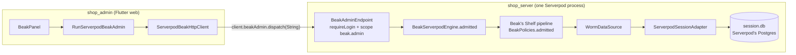

# How the admin app works

After this page you can follow one click in the panel through Serverpod to a row
in Postgres, and name the package that does each hop.

## The idea in one picture

## How it works

### The panel side

`runServerpodBeakAdmin` builds the client, restores the session, resolves roles
and hands `BeakPanel` a data source over the tunnel. The panel's requests are
Beak's stock HTTP client; the transport underneath is one Serverpod method.

## The envelope

A Beak request becomes one JSON string, envelope version 1: `v`, `method`,
`path`, `query`, `headers`, `body`. The answer is another string. `BeakWireRequest`
and `BeakWireResponse` live in `beak_serverpod`, so both ends share them. Only
four request headers survive; identity never comes from the envelope.

## The gate and the endpoint

`BeakAdminGate` overrides two getters, so Serverpod enforces sign-in and the
scope before the method body runs. The engine then resolves the principal from
the Serverpod session and runs the pipeline on the request's own session, pool
and transaction.

## The engine

`BeakServerpodEngine.admitted` registers the generated models, binds the
authored definitions, derives `BeakPolicies.admitted` from each model's
permissions and admission, validates the write bindings and composes the tree
rules. Stock persistence, a server stamp and a use-case write all run inside the
same save transaction.

## What it means for you

The panel's access checks come from data, but the server re-checks every request.

## Why it is shaped this way

The generated package has no Flutter dependency, so the server can import the same definitions; the panel stays a thin transport over the tunnel.

## What the panel is allowed to know

The model's `capabilities`, `permissions` and `admission` are data. A relation
whose target the account cannot read is not offered; a write field outside
`admission.writable` is not rendered; a command without its role is absent. The
server checks all of it again.

## Continue reading

- [Setting up the admin app](setup.md): the steps with real files.
- [Generating the schema package](generate.md): where the models come from.
- [Writes, commands and trees](write-bindings.md): how a save reaches a use case.
