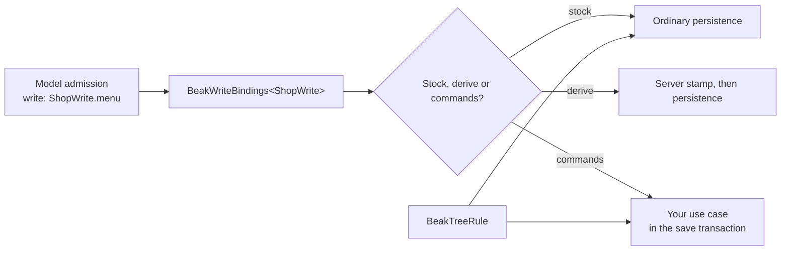

# Writes, commands and trees

After this page you can connect a generated model's writes to the use cases your server already has, and add the two structural rules an admin needs for category or navigation trees. The panel needs no change: it offers only the writes the model's admission and permissions allow.

## The idea in one picture



Every generated model names how its writes are persisted in
`admission.write`. The server maps those names to one handler each; the
generated enum has no value the switch does not mention, so adding a write
binding is a compile error until you decide who executes it.

## Binding the writes

```dart title="server/lib/src/admin_writes.dart"
final qateryWrites = BeakWriteBindings<QateryAdminWrite>(
  (binding) => switch (binding) {
    QateryAdminWrite.configuration => const BeakWriteHandler.stock(),
    QateryAdminWrite.menu => const BeakWriteHandler.derive(stampPublication),
    QateryAdminWrite.order => BeakWriteHandler.commands(
      actions: {OrderActions.cancel: cancelOrder},
      otherwise: BeakUnmatched.refuse,
    ),
  },
);
```

- `BeakWriteHandler.stock()` persists the validated request the ordinary way.
  It is the right handler for configuration records with no side effects.
- `BeakWriteHandler.derive(derive)` stamps trusted scalar values (who
  published this, and when) and then persists the stock way. The caller cannot
  set those values.
- `BeakWriteHandler.commands(...)` delegates an operation to a domain write.
  `actions` binds a model command; `create`, `update` and `delete` take over
  those operations; `otherwise: BeakUnmatched.refuse` closes stock persistence
  for a model whose use cases own every change.

A domain write receives a `BeakSaveOperationContext`, runs inside the save
transaction, and returns the identity it persisted:

```dart
Future<Object?> cancelOrder(BeakSaveOperationContext context) async {
  context.requireCommandOnly();
  await CancelOrderUseCase()(QateryServer.session, orderId: context.id);
  return context.id;
}
```

Returning an id makes Beak read the stored row back in the same transaction
(`BeakSaveOperationWrite.persisted`). Return `null` only when there is nothing
to read back, such as a delete. `context.merged` is the stored record with the
validated input laid over it, and `context.requireCommandOnly()` refuses a
command that also changes other fields.

### Validating at startup

```dart
qateryWrites.validate(registry);
```

This fails loudly when a writable model names no binding, a binding is of
another enum, a handler binds a command the model does not declare, or a
read-only model reports a write binding. Run it in `main`, before the server
accepts a request.

### Restoring a soft-deleted row

Set `restoreKey:` in the inventory for a translation table (the generator
detects the unique index over the owner foreign key and the locale). Creating a
row with a key the trash still holds restores that row instead of inserting a
second one, keeping its identity and creation time. A live duplicate is a field
error on the last key column. No handler code is involved.

## Keeping a tree a tree

A category or navigation tree needs three checks the stock persistence does not
know: no cycles, no orphaned children, and no sibling value used twice.

```dart
final categoryTree = BeakTreeRule(
  parent: ProductCategoryModel.parent,
  children: ProductCategoryModel.children,
  sameAs: [ProductCategoryModel.slug],
  maxDepth: 3,
  referencedBy: [ProductModel.categoryId],
);
```

`BeakTreeRule` runs inside the save transaction, ahead of your `preparePlan`.
It locks the tree's rows first (`SELECT … FOR UPDATE` on PostgreSQL) so two
admins moving the same branches cannot both validate against the state before
the other; locks are taken in table-name order and rows in primary-key order.
Pass `lockRows: false` for a tree small and cold enough that the lock costs more
than the race.

The rule rejects a save that would:

- move a record under itself or one of its descendants,
- delete a record that still has children or references named in
  `referencedBy`,
- repeat a sibling value named in `sameAs`,
- grow the tree past `maxDepth` (the root is level 0).

Cycles and over-deep moves are validation errors keyed on the parent field, so
the form highlights the offending picker. A blocked delete is a conflict.

## Composing the engine

```dart
final engine = BeakServerpodEngine.admitted(
  models: qateryAdminModels,
  definitions: qateryAdminDefinitions,
  principal: resolveQateryPrincipal,
  writes: qateryWrites,
  trees: [categoryTree, navigationTree],
  mapException: mapQateryException,
);
```

`admitted` registers the models, binds the authored definitions, derives the
policy from each model's permissions, admission and capabilities, validates the
write bindings and runs the tree rules. `mapException` converts a host exception
thrown by a preparer, a write or a finalizer into a `BeakException`, so the
caller gets a typed status and message.

### Pruning receipts

Commit receipts protect retries; they have no automatic expiry.
`engine.pruneExpiredReceipts(session)` deletes the ones older than 30 days
(`BeakServerpodEngine.receiptRetention`). Schedule it from a `FutureCall` in the
host package, which is the only place Serverpod discovers scheduled work.

## Continue reading

- [How the admin app works](how-it-works.md): the request path these hooks run on.
- [Setting up the admin app](setup.md): the generated model package and the endpoint.
- [Graph business rules](../../backend/graph-business-rules.md): the request-level graph the tree rules validate.
