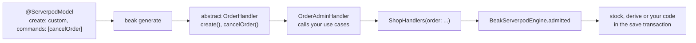

# Writes, commands and trees

After this page you can open a model's writes on its definition class, run the
custom ones through the use cases your server already has, and add the
structural rules an admin needs for category or navigation trees. The panel
needs no change: it offers only the writes the model's admission and
permissions allow.

## The idea in one picture



Each operation of a definition class is `off`, `stock`, `derived` or `custom`.
`beak generate` writes one abstract handler class per model that runs code of
its own, with one abstract method per custom operation and command, and an
aggregate that requires every handler. A missing implementation does not
compile.

## At a glance

| You want | Declare | Implement |
| --- | --- | --- |
| Plain persistence | `create: BeakHandling.stock` (or `@ServerpodModel.editable()`) | nothing |
| A server stamp, then persistence | `update: BeakHandling.derived` | `derive(write)` |
| An existing use case owns the write | `create: BeakHandling.custom` | `create(write)` |
| A command such as cancel or revoke | `commands: ['cancelOrder']` | `cancelOrder(write)` |
| Fewer rows for some accounts | `list: BeakHandling.custom` | `scope(principal)` |
| A tree that stays a tree | `BeakTreeRule` in `trees:` | nothing |

## Opening the writes

```dart
@Resource()
@ServerpodModel(
  area: 'sales',
  create: BeakHandling.custom,
  commands: ['revokeVoucher'],
)
final class Voucher extends BeakSchema {
  static BeakModelBehavior get behavior =>
      BeakModelBehavior(actions: [VoucherActions.revoke]);

  @Display()
  late final String code;

  late final VoucherDiscountType discountType;

  late final int? valueInCents;

  @ReadOnly()
  late final DateTime? revokedAt;
}
```

- `stock` persists the validated request through Serverpod's database. It is
  right for configuration records with no side effects.
- `derived` persists the stock way after the handler's `derive` lays trusted
  values over the request (who published this, and when). A derived value may
  be a field the caller cannot write.
- `custom` hands the operation to the handler. On `list`, the handler's
  `scope` narrows the rows a list, a count, an export and opening one record
  reach.
- A command in `commands:` is saved as an update that changes no field; the
  model's behavior must declare an action of that name, or the engine refuses
  to start. A plain update of a model whose `update` is `off` is refused.
- An operation that stays `off` is not offered and is refused on the server.

Beak has checked permissions, admission and rules before a handler runs, the
handler runs inside the request's transaction, and an exception it throws goes
through the engine's `mapException`. A handler replaces how an operation is
done, never whether it is allowed.

## The generated handler

For the voucher above, `generate.handlers` receives `voucher_handler.dart`:

```dart
extension type VoucherWrite._(BeakServerpodWrite _write)
    implements BeakServerpodWrite {
  VoucherWrite.of(BeakSaveOperationContext context)
    : _write = BeakServerpodWrite(context);

  VoucherValues get record => VoucherValues(values);
  VoucherValues? get before => ...;
}

extension type const VoucherValues(BeakRecord raw) {
  String get code => admin.VoucherModel.fields.code.require(raw);
  protocol.VoucherDiscountType get discountType => ...;
  int? get valueInCents => admin.VoucherModel.fields.valueInCents.readFrom(raw);
}

abstract base class VoucherHandler {
  const VoucherHandler();

  Future<Object?> create(VoucherWrite write);
  Future<Object?> revokeVoucher(VoucherWrite write);

  BeakWriteHandler get writes => ...;
}
```

`VoucherValues` reads each field the way Serverpod types it: a UUID as
`UuidValue`, an enum as the Serverpod protocol enum, a required field without
a value as a field error, a required field with a Serverpod default as that
default. `write.record` is the stored record with the change laid over it,
`write.before` the stored record (`null` for a create).

## Implementing it

The implementation calls the same use case the rest of the server calls, with
Beak's transaction:

```dart
final class VoucherAdminHandler extends VoucherHandler {
  const VoucherAdminHandler();

  @override
  Future<Object?> create(VoucherWrite write) async {
    final record = write.record;
    final voucher = await CreateCodeVoucherUseCase()(
      write.session,
      id: write.uuid,
      code: record.code,
      discountType: record.discountType,
      valueInCents: record.valueInCents,
      transaction: write.transaction,
    );
    return voucher.id;
  }

  @override
  Future<Object?> revokeVoucher(VoucherWrite write) async {
    final voucher = await RevokeVoucherUseCase()(
      write.session,
      voucherId: write.uuid,
      transaction: write.transaction,
    );
    return voucher.id;
  }
}
```

Returning an id makes Beak read the stored row back in the same transaction.
A delete returns nothing. A derived operation returns the values to lay over
the request, or `null` for none:

```dart
final class MenuAdminHandler extends DailyMenuHandler {
  const MenuAdminHandler();

  @override
  BeakRecord? derive(DailyMenuWrite write) {
    if (!write.runs(MenuActions.publish)) return null;
    return const DailyMenuModel().record([
      DailyMenuModel.publishedAt.to(DateTime.now().toUtc()),
      DailyMenuModel.publishedById.to(write.principal?.id),
    ]);
  }
}
```

| `BeakServerpodWrite` member | What it is |
| --- | --- |
| `session`, `transaction` | The request's Serverpod session and the transaction Beak saves in; pass `transaction` to every use case and ORM call |
| `kind` | Create, update (a command is one) or delete |
| `principal` | Who is saving |
| `id`, `uuid` | The record's id (a create carries the one Beak generated), and the same as a `UuidValue` |
| `values`, `changes`, `existing` | The record after the write, only what the caller sent, the stored record |
| `arguments` | The command's typed input (a `@CommandInput` model's values) |
| `runs(action)` | Whether this save runs that command |

`BeakServerpodValues.uuid(value)` turns stored text into a `UuidValue` and
refuses anything else with a validation error.

## Composing the engine

```dart
final engine = BeakServerpodEngine.admitted(
  models: shopModels,
  handlers: const ShopHandlers(
    order: OrderAdminHandler(),
    voucher: VoucherAdminHandler(),
  ),
  principal: resolveShopPrincipal,
  trees: [categoryTree, navigationTree],
  mapException: mapShopException,
);
```

`admitted` registers the models, derives the policy from each model's
permissions, admission, capabilities and the handlers' row scopes, and checks
the write bindings: a writable model without one, or a handler bound to a
command the model does not declare, stops the engine before it serves a
request. `mapException` converts a host exception thrown by a preparer, a
handler or a finalizer into a `BeakException`, so the caller gets a typed
status and message. A project whose models are all stock passes
`const ShopHandlers()`.

### Restoring a soft-deleted row

A writable translation table (a unique index over the owner foreign key and
the locale) restores a soft-deleted row: creating a row with a key the trash
still holds brings that row back instead of inserting a second one, keeping
its identity and creation time. `@ServerpodModel(restoreKey: [...])` names the
fields for any other table. A live duplicate is a field error on the last key
column. No handler code is involved.

## Keeping a tree a tree

A category or navigation tree needs three checks the stock persistence does not
know: no cycles, no orphaned children, and no sibling value used twice.

```dart
final categoryTree = BeakTreeRule(
  parent: ProductCategoryModel.parent,
  children: ProductCategoryModel.children,
  sameAs: [ProductCategoryModel.slug],
  maxDepth: 3,
  referencedBy: [ProductModel.categoryId],
);
```

`BeakTreeRule` runs inside the save transaction, ahead of your `preparePlan`.
It locks the tree's rows first (`SELECT … FOR UPDATE` on PostgreSQL) so two
admins moving the same branches cannot both validate against the state before
the other; locks are taken in table-name order and rows in primary-key order.
Pass `lockRows: false` for a tree small and cold enough that the lock costs more
than the race.

The rule rejects a save that would:

- move a record under itself or one of its descendants,
- delete a record that still has children or references named in
  `referencedBy`,
- repeat a sibling value named in `sameAs`,
- grow the tree past `maxDepth` (the root is level 0).

Cycles and over-deep moves are validation errors keyed on the parent field, so
the form highlights the offending picker. A blocked delete is a conflict.

## Rules and limits

- A command is a bare update with no other field changes; Beak refuses one
  that also changes a field.
- A custom create or update returns the persisted id; Beak re-reads the row in
  the same transaction.
- A custom list narrows the stock query; a handler does not answer a list from
  its own code.
- Tree rules lock small trees only; use `lockRows: false` for a cold tree.

## Verify it

- The server compiles with every required handler passed to `<Prefix>Handlers`.
- The engine starts, so every command a handler runs is declared.
- A command with extra field values is refused.
- A blocked delete is a conflict; a cycle is a field error on the parent.

## Reference

- `packages/beak_serverpod_server/lib/src/beak_serverpod_write.dart`
- `packages/beak_cli/lib/src/serverpod/handler_emitter.dart`
- `packages/beak_backend/lib/src/writes/`
- `packages/beak_backend/lib/src/auth/beak_tree_rule.dart`
- `packages/beak_serverpod_server/lib/src/beak_serverpod_engine.dart`

### Pruning receipts

Commit receipts protect retries; they have no automatic expiry.
`engine.pruneExpiredReceipts(session)` deletes the ones older than 30 days
(`BeakServerpodEngine.receiptRetention`). Schedule it from a `FutureCall` in the
host package, which is the only place Serverpod discovers scheduled work.

## Continue reading

- [How the admin app works](how-it-works.md): the request path these hooks run on.
- [Setting up the admin app](setup.md): the definitions package and the endpoint.
- [Graph business rules](../../backend/graph-business-rules.md): the request-level graph the tree rules validate.
